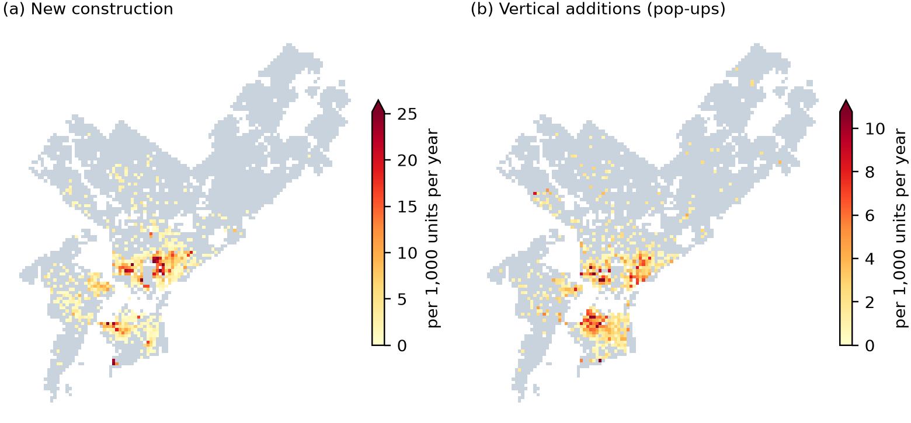

# Teaching Aerial Imagery to See Height: Tracking Philadelphia's Gentle Densification with LiDAR-Supervised Foundation Models

**Xuanyu Zhou**

## 1. Background and Research Questions

Infill construction and vertical additions ("pop-ups") add housing along existing streets and transit corridors. In Philadelphia, this incremental densification occurs one lot at a time and has sparked enough debate to prompt City Council caps in parts of the city [3]. However, the city lacks a reliable record of *where* and *when* buildings actually grow, as building permits track intent rather than outcomes.

While LiDAR accurately measures building height, it is flown only every three to four years (2018, 2022, 2025). Conversely, aerial orthoimagery is captured annually each spring but lacks elevation data. Inspired by Canopy Height Maps v2, where LiDAR supervision raised $R^2$ for tree height from $0.53$ to $0.86$ [1, 2], this project uses multi-year LiDAR flights to supervise a foundation model that infers height changes from annual imagery. While standard building change detectors achieve $92\text{--}95\%$ $F_1$ scores on dense, pixel-level benchmarks [8], performance drops to $81\%$ under sparse changes [9] and $69\%$ in unseen cities [10]. In our study area, fewer than $0.3\%$ of building units change per period, and vertical additions often add just a single story to an existing roof.

- **RQ1 (Model):** Can a LiDAR-supervised, bi-temporal DINOv3 model date new construction from annual imagery across unseen locations and years? At what spatial scale is it reliable, and can it detect vertical additions?
- **RQ2 (Urban):** Where, how much, and *when* did Philadelphia densify between 2018 and 2025 relative to transit access and neighborhood socioeconomic shifts?
- **RQ3 (Governance):** What share of building permits results in visible construction, what is the lag time, and how much construction occurs without a matching permit?

**Scope:** $152.5\text{ km}^2$ of residential and low-to-mid-density mixed-use zoning across 46 ZIP codes ($\sim 527,000$ building units).

## 2. Data Sources

| Data | Coverage | Role |
|---|---|---|
| LiDAR point clouds (PASDA) [5] | 2018, 2022, 2025 ($15\text{--}50\text{ pts/m}^2$); 2010, 2015 (sparse) | Ground-truth height, change labels, model anchors |
| Aerial orthoimagery ($\sim 0.23\text{ m}$, spring) [5] | 2010, 2015, 2018–2020, 2022–2025 | Model input |
| L&I building permits [4] | 2014–2025 ($257,160$ records) | Permit-to-construction matching (RQ3) |
| Parcels, building footprints, zoning [4] | Citywide | Spatial analysis units and study area |
| ACS 5-year estimates [6], TIGER block groups | 2015–2019, 2019–2023 | Socioeconomic and demographic change (RQ2) |
| SEPTA GTFS [7] | Current network | Transit accessibility (distance to rail stops, RQ2) |

## 3. Proposed AI Methods

**Labels:** LiDAR elevation rules flag new construction, vertical additions, and demolitions per building unit ($95.5\text{--}95.7\%$ precision verified via blind sampling).

**Backbone Selection:** Three architectures were benchmarked on single-image height estimation across held-out ZIP codes and years:

| Model | Pretraining | Building Height Error (MAE) |
|---|---|---|
| U-Net (ResNet-34) | ImageNet | $1.26\text{--}2.10\text{ m}$ (worst on 2025) |
| DINOv3 (frozen, linear head) | Satellite imagery (SAT-493M) | $1.75\text{--}2.39\text{ m}$ |
| **DINOv3 + DPT decoder (fine-tuned)** | Satellite imagery (SAT-493M) | **$1.17\text{--}1.60\text{ m}$** |

**Bi-Temporal Architecture:** A single image shows a state, not a change, so the final model compares two years. The DINOv3 encoder extracts features from the anchor-year and target-year images, and the DPT decoder fuses them with the anchor-year LiDAR height, which supplies the height the images lack. Two per-unit classification heads score whether the unit *grew* (any height gain) and whether that gain is a *vertical addition*; new construction is a unit that grew but is not scored as a vertical addition. The model is trained on $10,559$ image–LiDAR pairs (2010–2022 across 37 ZIP codes).

**Evaluation:** We evaluate the model at the building-unit level under true class imbalance across 8 sealed ZIP codes and an unseen period ($2022 \to 2025$), run once under decision rules fixed in advance. Predicted counts are aggregated to $100\text{ m}$ cells, $250\text{ m}$ cells, and census block groups for comparison against LiDAR ground truth. The model estimates the inter-flight years (2019, 2020, 2023, 2024) from that year's imagery only for tasks achieving $r \ge 0.8$ at the $250\text{ m}$ scale.

**Urban Analysis:** Annualized change rates per $1,000$ units, block-group negative binomial regressions, and parcel-level permit matching.

## 4. Expected Outcomes and Progress

| Outcome | Status |
|---|---|
| **RQ1: New construction** | **Completed.** Model counts correlate with LiDAR at $r = 0.96$ per $250\text{ m}$ cell ($12\%$ under-count), enabling new construction to be dated at the $250\text{ m}$ scale for 2019, 2020, 2023, and 2024. |
| **RQ1: Vertical additions** | **Completed.** Low detectability from nadir imagery ($\text{AP} = 0.15, r = 0.42$); vertical additions are therefore analyzed using LiDAR years only. |
| **RQ2: Densification patterns** | **Completed.** New construction slowed from $1.62$ to $1.20$ per $1,000$ units/year (2018–2022 vs. 2022–2025). Growth is highly concentrated: $10\%$ of $250\text{ m}$ cells capture $94\%$ of new construction (Figure 1), with minimal activity beyond $1.6\text{ km}$ from rail transit. |
| **RQ3: Permit analysis** | **Completed.** $61\%$ of new-construction permits (2018–2020) show new construction in LiDAR by 2025, while $3.6\text{--}9.1\%$ of detected changes lacked corresponding permits. |
| **Deliverables** | **In progress.** Interactive web map, final report, and presentation. |

**Figure 1.** LiDAR-measured new construction (a) and vertical additions (b) per $250\text{ m}$ cell ($2018 \to 2025$, annualized per $1,000$ building units).

**Limitations:** Findings are valid at aggregate scales ($250\text{ m}$ cells and block groups) rather than individual buildings, and reflect spatial associations rather than causal effects.

## References

1. Meta AI and World Resources Institute (2026). *Canopy Height Maps v2.* https://ai.meta.com/blog/world-resources-institute-dino-canopy-height-maps-v2/
2. Siméoni, O., et al. (2025). *DINOv3.* arXiv:2508.10104.
3. City of Philadelphia, Bill No. 230574 (2023), Brewerytown–Sharswood overlay.
4. City of Philadelphia, L&I permits, parcels, footprints and zoning base districts, OpenDataPhilly.
5. PASDA, Philadelphia LiDAR and aerial photography, 2010–2025.
6. U.S. Census Bureau, American Community Survey 5-year summary files, 2015–2019 and 2019–2023.
7. SEPTA, GTFS public feed (2026).
8. Zhu, D., et al. (2024). *ChangeViT: Unleashing plain vision transformers for change detection.* arXiv:2406.12847.
9. Wang, Y., et al. (2026). *Multi-modal building change detection for large-scale small changes: Benchmark and baseline.* arXiv:2603.19077.
10. Pang, C., et al. (2023). *Detecting building changes with off-nadir aerial images.* Science China Information Sciences; arXiv:2301.10922.
