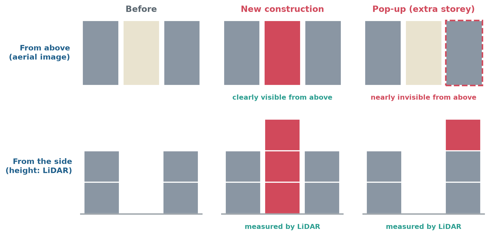
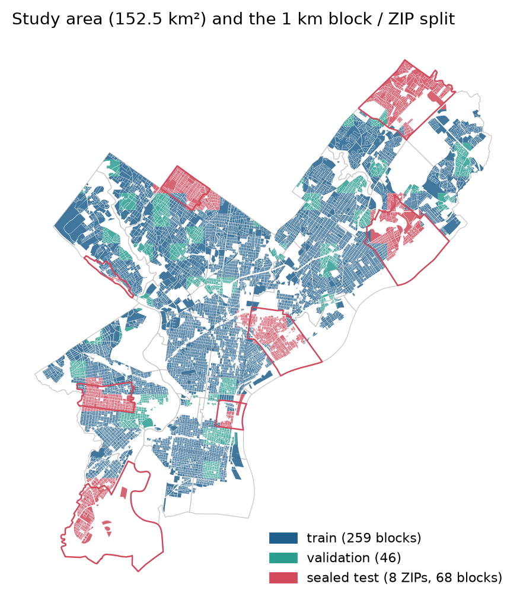
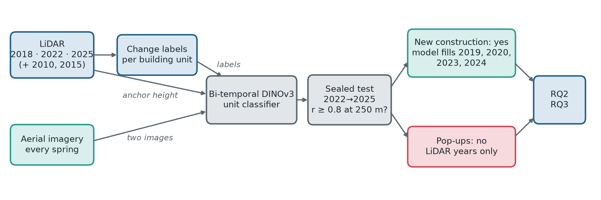
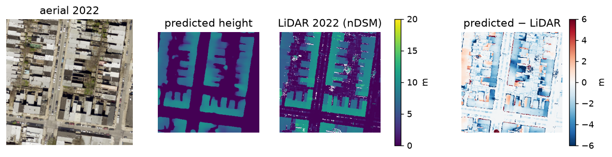
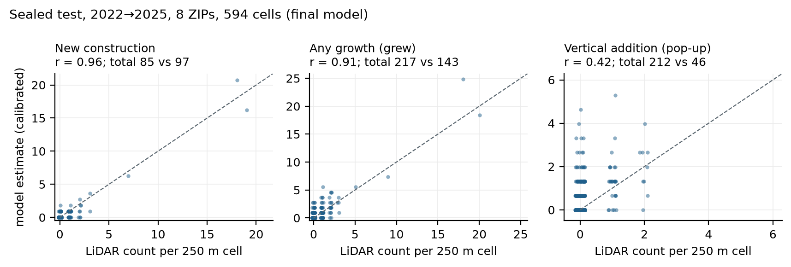
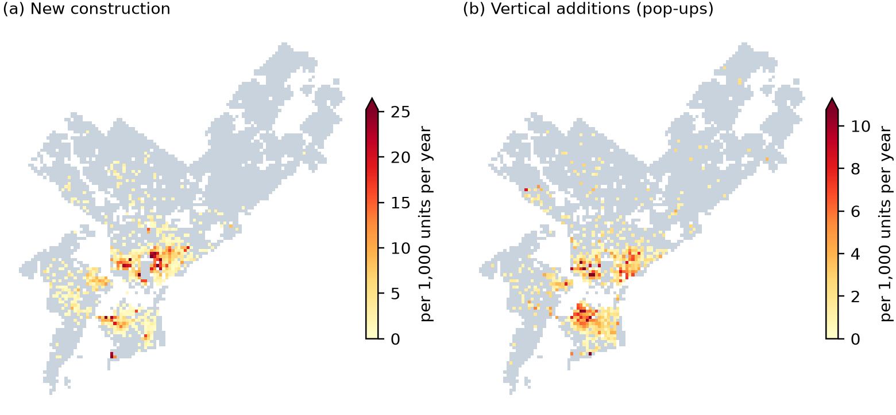
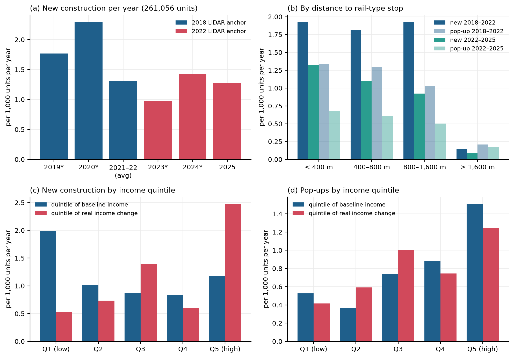
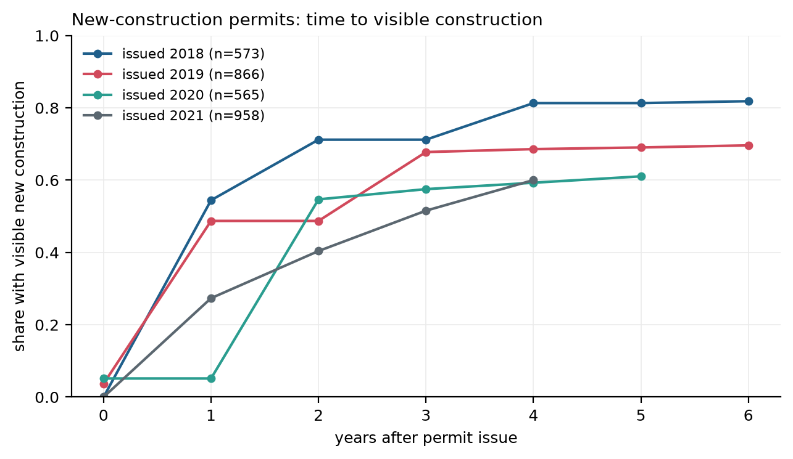
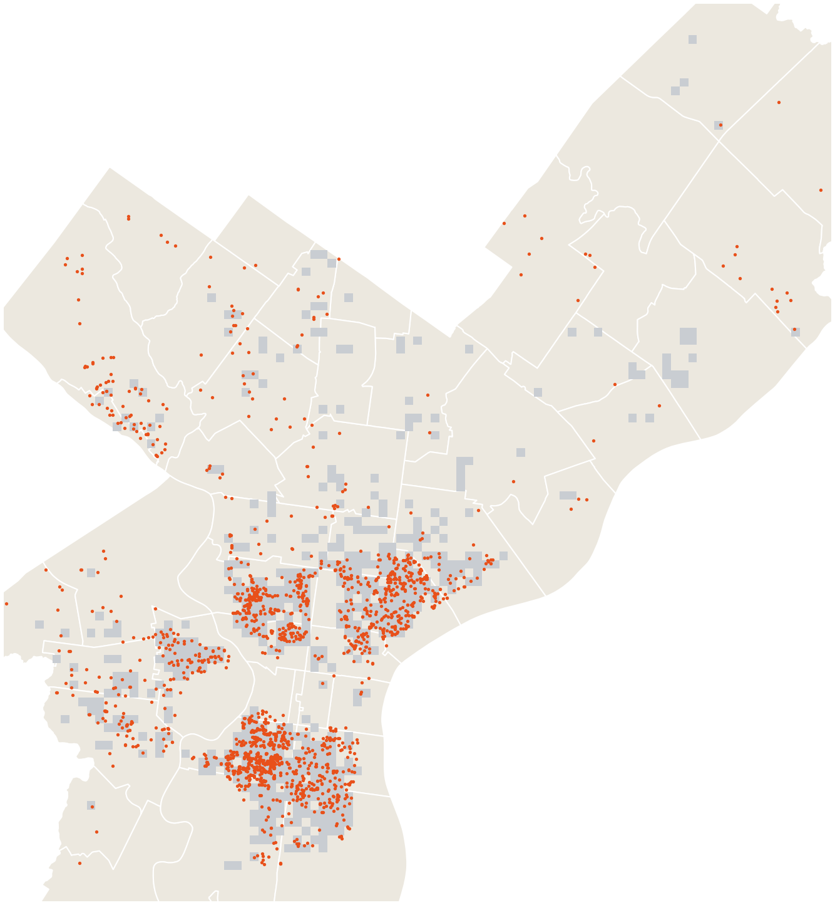

# Teaching Annual Aerial Imagery to See Growth: Tracking Philadelphia's Gentle Densification with LiDAR-Supervised Foundation Models

**Xuanyu Zhou**  
MUSA 6950 AI for Urban Sustainability, final report, November 2026

---

## Abstract

Philadelphia grows one lot at a time: new rowhouses fill vacant lots and existing homes gain an extra storey
("pop-ups"). Yet the city does not know where and when this happens; permits record intent, not outcomes. Airborne
LiDAR measures height precisely but is flown only every three to four years, while aerial imagery is flown every spring
but is flat. This project lets the rare, precise measurement teach the frequent, flat one.

Three citywide LiDAR flights (2018, 2022, 2025) label every building unit as new construction, pop-up or unchanged.
With these labels, a LiDAR-anchored, bi-temporal DINOv3 model learns to read change from two aerial images. On a
sealed test of 8 ZIP codes and the unseen period 2022→2025, its new-construction counts match LiDAR at **r = 0.96**
(95% interval 0.67–0.98) per 250 m cell, so annual imagery can fill the years between flights. Pop-ups fail
(r = 0.42): an added storey is nearly invisible from directly above. Street-level photographs, read by a
vision-language model, find them one building at a time: 1,950 buildings are marked as taller, and about four in five
of a sample checked by hand are added storeys or taller rebuilds. Counted per cell they reach r = 0.54, so pop-up
counts remain those of LiDAR.

With new construction dated year by year across 521,000 units, the city's growth becomes visible. Construction peaked
in 2020, and from 2018–22 to 2022–25 the yearly rate fell by 26% for new construction and 33% for pop-ups; 10% of
250 m cells hold 94% of new construction, almost all within 1.6 km of rail. 61% of new-construction permits issued in 2018–2020 were visibly built by 2025, and only 3.6–9.1% of visible
changes lack a matching permit.

From above, the model can see new buildings. New floors have to be found from the street.

---

## 1. Background: a city that grows one lot at a time

### 1.1 Gentle densification

Adding homes inside the existing city is one of the most sustainable ways for a region to grow: infill and vertical
additions reuse existing streets, transit and utilities, avoid greenfield land, and put residents where per-capita
travel and energy use are lowest. In Philadelphia this growth is "gentle": rowhouses on vacant lots, and two-storey
rowhouses raised to three or four storeys. These pop-ups are contested enough that City Council has capped them in
parts of the city, for example in Brewerytown–Sharswood (Bill No. 230574, 2023) [3].

Yet there is no record of *where* and *when* the built fabric actually grows. Permits record an application, not a
structure: many are never built, and some construction has none.

### 1.2 Three views, each missing something

The city has two views from above. **LiDAR** measures building height directly but is expensive and flown only every
three to four years (2018, 2022, 2025). **Aerial imagery** is flown every spring, but a photograph is flat. The idea of
this project is to let the first teach the second: LiDAR supplies labels and an anchor height, and a model learns to
read from each year's imagery which buildings have grown since the last flight. Meta and WRI used the same idea for
trees, raising R² for canopy height from 0.53 to 0.86 with a LiDAR-supervised DINOv3 [1, 2].

*Figure 1. The core difficulty. From above, new construction changes the picture, while a pop-up leaves the roof looking the same (dashed). From the side, both are changes in height, which LiDAR measures.*

Change is harder than height. Building change detectors reach F1 92–95% on the LEVIR-CD and WHU-CD benchmarks [10],
which are change-dense and scored per pixel, but drop to about 81% when changes are sparse [11] and to 69% in unseen
cities [12]. Philadelphia is the hard case: in the test period about 0.2% of units grew, and a pop-up raises an
existing roof by a single storey.

A third view is at street level. Photographs taken from cars show every storey of a house front, but only along the
streets that were driven, and only every few years [14]. The project turns to them for what cannot be seen from above
(Sections 3.6 and 4.4).

### 1.3 Research questions

- **RQ1 (Model).** Can LiDAR teach a foundation model to detect new construction and vertical additions from yearly
  aerial imagery in ZIP codes and a year it has never seen, and at what scale are its counts reliable enough
  (r ≥ 0.8 against LiDAR at 250 m) to fill the years between flights?
- **RQ2 (Urban).** How much, when and where did Philadelphia densify between 2018 and 2025, and how does this relate to
  rail access and neighbourhood income change?
- **RQ3 (Governance).** What share of building permits turns into visible construction, after how long, and what share
  of visible construction has no matching permit?

---

## 2. Study area and data

The study area is the city's residential and low/mid-density mixed-use zoning: 152.5 km² and 526,928 building units in
46 ZIP codes (rowhouse 100.0 km², detached 28.2 km², mixed use 24.3 km²). The high-density centre, industrial and
special-purpose districts are excluded, and 250 m cells dominated by high-rises are reported separately, leaving
520,903 units. An analysis unit is a 2016 parcel linked to the 2025 parcels, with overlapping parcels merged so that
lot splits do not look like construction.

*Figure 2. Study area by split: 1 km blocks for training and validation, with the 8 sealed test ZIPs outlined.*

| Data | Coverage | Role |
|---|---|---|
| LiDAR point clouds (PASDA) [5] | 2018, 2022, 2025 (15–50 pts/m²); 2010, 2015 (sparse, training area) | Teacher: height, change labels, anchor |
| Aerial orthoimagery (≈0.23 m, spring) [5] | 2018–2020, 2022–2025; 2010, 2015 (training area) | Model input |
| L&I building permits [4] | 2014–2025 (257,160 records) | RQ3 |
| Parcels, building footprints, zoning [4] | Citywide | Analysis units, study area |
| ACS 5-year estimates [6], TIGER block groups | 2015–19, 2019–23 | Income and population change (RQ2) |
| SEPTA GTFS [7] | Current network | Distance to rail stops (RQ2) |
| Street-level photographs [14] | 2007–2026, streets as driven | Finding pop-ups (Section 4.4) |

LiDAR was processed into 0.5 m height-above-ground grids with a vegetation mask (2,661 tiles). Vegetation needed care:
the 2022 cloud classifies only ground, so canopy is detected from multiple laser returns, and the 2025 flight
(18 April, leaves out) also uses the point classes. The 2018 flight is sparse outside the centre, so only 64% of units
are covered in both 2018 and 2022; period comparisons use those shared units.

---

## 3. Methods: teaching imagery to see growth

*Figure 3. Method. LiDAR supplies labels and the anchor height; the model reads two aerial images; the sealed test decides what the model may be used for.*

### 3.1 LiDAR as the teacher

For each unit and pair of flights, a building cell is higher than 2.5 m and not vegetation. **New construction** means
building cover rose from under 20% to over 50%; a **pop-up** means at least 30% of the earlier roof rose by 2.5 m or
more; **demolition** is the reverse of new construction. The labels are reliable: they recover 96.6% of completed
new-construction permits and 87.1% of upward-addition permits in the pilot ZIP, and 95.5% and 95.7% of flags were real
in two blind reviews.

### 3.2 First attempts: what one image and two images can see

**One image.** Three models learned to predict building height from a single 2018 image and were tested on 2022 and
2025 in held-out ZIPs:

| Model | Pretraining | Height error (MAE) | New construction R / P | Pop-ups R / P |
|---|---|---|---|---|
| U-Net (ResNet-34) | ImageNet | 1.26–2.10 m | 88% / 89% | 24% / 32% |
| DINOv3, frozen, linear head | Satellite (SAT-493M) | 1.75–2.39 m | 82% / 82% | 26% / 28% |
| **DINOv3 + DPT decoder [8], fine-tuned** | Satellite (SAT-493M) | **1.17–1.60 m** | **92% / 91%** | **44% / 44%** |

The satellite-pretrained foundation model was the most accurate and the most stable on new years. But even it found
fewer than half of the pop-ups, predicting a median rise of 1.9 m where LiDAR measured 3.8 m.

*Figure 4. Single-image height model on a held-out 128 m patch (2022): image, prediction, LiDAR and error (blue: predicted too low).*

**Two images.** A single image shows a state, not a change. Giving the model two images and asking for height change
made it predict "no change" everywhere, because change is too rare per pixel. Adding the anchor-year LiDAR height made
it copy the anchor. What worked was to stop drawing heights and score each building unit directly.

### 3.3 The final model

A shared DINOv3 ViT-L/16 encoder reads the anchor-year and target-year images (128 m windows at 0.25 m). A DPT-style
decoder fuses the two feature maps, their difference, the anchor-year LiDAR height and the vegetation mask. Features
are pooled per unit, and two heads score whether the unit *grew* and whether that growth is a *pop-up* (focal loss [9]);
*new construction* is a unit that grew but is not a pop-up. The model was trained on 10,559 image–LiDAR pairs from six
periods (2010–2022) in 37 ZIP codes. Early runs often collapsed; positive oversampling, larger batches and weight
averaging made training stable. The final model reached validation AP 0.80 for *grew* and 0.43 for pop-ups;
subtracting the two photographs directly reaches 0.06 for *grew* on the same units.

### 3.4 One sealed test

Eight ZIP codes (15% of the study area) were drawn at random and sealed; the rest was split into 1 km blocks for
training and validation. The test period, 2022→2025, never entered training. The test scores building units at the
real change rate, compares calibrated counts with LiDAR at 100 m, 250 m and block group, and was run once under rules
written beforehand, including the 0.8 gate for using model estimates between flights.

Everything applied to the test was fixed on the validation blocks (2018→2022) before the test was opened. Each head's
threshold maximises F1 on validation. Counts are then calibrated per class by one factor, validation precision ÷
validation recall, so that flags × factor estimates the true number: 0.92 for *grew*, 0.90 for new construction and
0.66 for pop-ups. No parameter was fitted on test data.

### 3.5 Filling the years and analysing the city

The final model scored the 2019 and 2020 images against the 2018 anchor, and the 2023 and 2024 images against the 2022
anchor. The yearly series uses one fixed set of 261,056 units covered by both anchors and both LiDAR periods, so
that a change of denominator cannot pass for a trend. RQ2 uses rates per 1,000 units per year, maps at 250 m and
block group, distance to rail-type stops, and negative binomial models per block group (rail distance, income level and
change, population change, rowhouse share). RQ3 matches permits to units by property account. Outputs are
aggregated, except one map of the buildings found from the street (Figure 9), and no address is published.

### 3.6 A second look from the street

An added storey shows from the side, so pop-ups were also looked for in street-level photographs. Candidates are
units with a model pop-up score above its threshold or with a permit for an upward addition; the search for buildings
(Section 4.4) adds units with a zoning permit for an addition or new development. For each candidate, the capture
point nearest the lot supplies one photograph per period (before the 2018 flight, 2018–2019, 2020–2023, from 2024),
cut from the panorama towards the lot. A vision-language model (Gemini 3.8 Flash [15]; for candidates outside the densest cells the cheaper Gemini
Decision 1 [16]) reads the two to five dated
photographs together and answers whether the building became taller, was newly built, did not change or cannot be
judged, and between which two photographs it changed. Prompt, photographs and candidate rule were settled in one ZIP
code and frozen. Counts per 250 m cell were then compared with LiDAR once, in the 8 sealed ZIP codes, under the same
0.8 bar; a candidate without photographs was given the mean of the judged candidates from the same source.

---

## 4. Results

### 4.1 RQ1 — What the model can see, and where it stops

**Sealed test, 2022→2025, 62,422 units:**

| | Unit AP | r at 100 m | r at 250 m | r at block group | Count, model vs LiDAR |
|---|---|---|---|---|---|
| New construction | –† | 0.90 | **0.96** | 0.97 | 85 vs 97 |
| Grew (any) | 0.68 | 0.82 | 0.91 | 0.94 | 217 vs 143 |
| Pop-up | 0.15 | 0.31 | **0.42** | 0.43 | 212 vs 46 |

† New construction is a rule on two thresholded heads, not a score, so it has no AP; its unit-level precision is
72% and recall 70% (68 of 94 flags; computed afterwards from the saved test predictions). The rows do not add up
(85 + 212 ≠ 217) because each class is calibrated with its own factor and the pop-up head runs independently of
the *grew* head: 179 of its 321 flags fall on units not flagged as grown. In the LiDAR labels new construction and
pop-ups partition *grew* exactly (97 + 46 = 143).

*Figure 5. Sealed test: calibrated model counts vs LiDAR counts per 250 m cell (dashed: perfect agreement).*

**New construction: the model sees it.** Counts track LiDAR at r = 0.96 per 250 m cell (95% bootstrap interval
0.67–0.98, from resampling the cells afterwards) with a 12% under-count. This passes the 0.8 bar set beforehand, so
the model dates new construction in 2019, 2020, 2023 and 2024. Single units are less reliable
(about 70% precision and recall), which is why results are reported for cells and block groups.

**Pop-ups: it does not.** r = 0.42 fails the gate, so pop-ups come from LiDAR years only. Two things combine. Physically,
an added storey is nearly invisible from directly above; every model in this project failed on pop-ups, and human
reviewers found them the hardest cases too. And pop-ups were five times rarer in the test period (0.07% of units) than
in validation (0.40%), so false alarms outnumbered them even though recall held at about 52%.

For comparison, published scores are pixel-level and come from change-dense data within one region [10]; this test
scores rare changes per building in unseen places and an unseen year.

**Answer to RQ1.** Yes for new construction, no for pop-ups. LiDAR can teach a foundation model to date new
construction from yearly imagery, reliably at 250 m cells and block groups. It cannot teach it to see added storeys:
the information is not in the photograph. Section 4.4 looks for them from the street.

### 4.2 RQ2 — How much, when and where did Philadelphia densify?

**How much** (LiDAR, per 1,000 units per year, units covered in both periods):

| | 2018–2022 | 2022–2025 | Change |
|---|---|---|---|
| New construction | 1.62 | 1.20 | −26% |
| Pop-ups | 1.06 | 0.71 | −33% |
| Demolition | 0.62 | 0.58 | −6% |

**When** (new construction per 1,000 units per year, the same 261,056 units throughout; * model estimate, other
years LiDAR minus the model years):

| 2019* | 2020* | 2021–22 avg | 2023* | 2024* | 2025 |
|---|---|---|---|---|---|
| 1.77 | 2.30 | 1.30 | 0.98 | 1.43 | 1.28 |

Years run from one spring flight to the next. Construction peaked in 2020 and ran at about half the 2020 rate in
2023–2025. Because the model under-counts by about 12%, some 2019–2020 construction falls into the 2021–22 remainder,
so the true peak is at least this sharp. Only the model years reveal this timing.

**Where.** Only 15% of 250 m cells saw any new construction or pop-up, and the top 10% hold **94% of new construction
and 90% of pop-ups** (Figure 6). The hot spots lie north of Center City and in South Philadelphia (ZIPs 19122, 19121,
19146, 19123, 19125 for new construction). Mixed-use units densify fastest, rowhouse units next, detached areas almost
not at all.

*Figure 6. LiDAR-measured new construction (a) and pop-ups (b) per 250 m cell, 2018→2025, per 1,000 units per year (grey: none).*

**Rail.** Of all units, 83–86% lie within 1.6 km of a rail-type stop (subway, trolley or regional rail), and they hold
98–99% of new construction; beyond 1.6 km rates collapse (new construction 0.14 vs 1.93 per 1,000 per year under
400 m, 2018–22). Raw rates differ little inside 1.6 km, but with income and housing type held constant, new
construction at 400–800 m runs at 0.57 [0.37, 0.88] of the rate under 400 m. Beyond 1.6 km the incidence-rate ratio
is 0.04 [0.02, 0.08] for new construction and 0.15 [0.09, 0.24] for pop-ups.

**Income.** The two forms of growth follow different neighbourhoods. New construction is highest in the lowest-income
block groups, where the vacant lots are (IRR Q1 vs Q3 2.11), and where real incomes rose fastest (IRR 1.35 per SD);
the highest-income quintile comes second (1.17 per 1,000 per year, against 0.84–1.01 in the middle three).
Pop-ups rise with baseline income (IRR Q5 vs Q3 2.79). These are associations: construction also changes who lives in
a place.

*Figure 7. (a) New construction per year on one fixed set of 261,056 units; starred years are model estimates, 2021–22 and 2025 are LiDAR minus the model years. (b) Rates by distance to the nearest rail-type stop. (c, d) New construction and pop-ups by block-group quintile of baseline income and of real income change.*

In floor area, new construction added roughly 1.3 M m² in 2018–22 (about 10,400 homes) and 0.8 M m² in 2022–25
(about 6,800 homes).

**Answer to RQ2.** Gentle densification peaked in 2020; from 2018–22 to 2022–25 its yearly rate fell by 26% for new
construction and 33% for pop-ups. A tenth of
the residential city holds over 90% of it, almost all within 1.6 km of rail; new construction follows low and rising
incomes, pop-ups follow high incomes.

### 4.3 RQ3 — Permits and visible construction

| Permits issued 2018–2020 | Visible by 2022 | Visible by 2025 |
|---|---|---|
| New construction (2,754 units) | 58% | 61% |
| Upward addition (497) | 65% | 67% |

About half of new-construction permits issued in 2018–2019 show construction within one year and 70–80% within four
(Figure 8). In the other direction, 3.6% (2018–22) and 6.8% (2022–25) of new construction, and 4.4% and 9.1% of
pop-ups, have no related permit on the parcel; counting permits on adjacent parcels halves these shares, so part of
the remainder is parcel matching rather than unpermitted work.

*Figure 8. Share of new-construction permits with visible construction, by years after issue. There is no 2021 imagery, so curves are flat across 2021 (e.g. permits issued 2020 at year 1).*

**Answer to RQ3.** About 60% of new-construction permits become visible construction by 2025, and about half within
a year of issue, and only a small share of visible change lacks a permit. The permit record is a reasonable but lagged
picture of what gets built.

### 4.4 Pop-ups from the street

**Counting.** In the sealed ZIP codes 917 candidates were checked, and 61% had photographs on both sides of
2018–2025. Street-view counts per 250 m cell correlate with the LiDAR pop-ups of both periods at r = 0.54 (95%
interval 0.39–0.66; 0.67 per block group), against 0.42 for the aerial model. The 0.8 bar is not met. About three in
ten candidates stand on streets with no recent photograph, an addition set back from the façade is hidden from a
camera a few metres in front of it, and outside its training area the aerial model proposes few true pop-ups: 4% of
its candidates are seen taller, against 24% of those with an upward-addition permit. Pop-up counts therefore remain
those of LiDAR.

**Finding.** Street view does find pop-ups one building at a time. Of 23,819 candidates, 16,738 (70%) had
photographs on both sides of 2018–2025 and were judged. In the 571 cells where the aerial model flags at least three
buildings as grown, Gemini 3.8 Flash marks 1,538 buildings as taller; in the rest of the study area Gemini Decision 1,
at an eighth of the cost, adds 412. Of the 1,950 buildings (Figure 9), 641 are first seen taller in the 2018–2019
photographs, 441 in 2020–2023 and 868 from 2024. In a blind check by hand of 58 buildings marked by Gemini 3.8 Flash,
47 (81%, 95% interval 69–89%) are added storeys or taller rebuilds, 10 are new buildings on lots that were empty in
the earlier photograph, and 1 is wrong; on the same houses Gemini Decision 1 agrees with the hand call on whether a
house changed in 87% of cases, against 95%. Of the candidates with an upward-addition permit, 45% are seen taller; of
those picked by the model score alone, 10%.

*Figure 9. The 1,950 buildings seen taller from the street between 2018 and 2025 (dots); grey: the 250 m cells where the aerial model flags at least three buildings as grown.*

---

## 5. Discussion

**What the AI adds.** The model turns three LiDAR snapshots into an annual series of new construction for half a
million units. That is what makes the "when" of RQ2 and the lags of RQ3 measurable, and each new spring of imagery can
be scored against the latest LiDAR without new labels. A vision-language model reading street-level photographs adds
the buildings themselves: LiDAR counts pop-ups per cell every few years, and the street shows which house grew and
between which photographs.

**Where it stops.** Added storeys are not visible from directly above, whatever the model. In principle a storey
of 3–4 m should lengthen the building's shadow in spring imagery, and a 128 m window is wide enough to contain it.
Two likely reasons this cue did not help, neither tested here: in rowhouse blocks the new shadow falls on the
neighbouring roof of the same height or into narrow rear yards already in shade, and the flights differ in date and
time of day, so shadows change between years even where nothing was built. Using shadows would need the sun position
of each flight as an input. Street-level photographs do show the extra storey (Section 4.4), but only on streets
driven in the right years, so they find pop-ups without counting them. Counts of rare changes also
need recalibration when their frequency shifts, ideally against each new LiDAR flight.

**For the city.** Philadelphia densifies near rail and on vacant lots in the urban core, but the pace is slowing and
confined to a small share of the city. The slowdown coincides with the pandemic, higher interest rates from 2022, and
the reduction of the city's ten-year tax abatement for new homes on 1 January 2022, which developers rushed to beat
with a record number of permit applications in 2021 [13]. New construction concentrates in low-income areas with rising
incomes, consistent with gentrification pressure; pop-ups, the target of height caps, concentrate in higher-income
areas. New construction can now be monitored every year from imagery; pop-ups still need LiDAR to be counted, and
street-level photographs point to the houses in between flights.

**Limitations.** Results hold for cells and block groups, not single buildings; pop-up trends rest on two LiDAR periods;
the 2018 flight covers only 64% of units; the buildings marked from the street were checked by hand on a sample of 58
and cover only streets with recent photographs; and the RQ2 relationships are associations, not causes.

The results are public as a story website with an interactive map. Its question-answering assistant, a language
model with tools that read only the aggregated tables, answers within these limits and moves the map to the areas it
describes: https://musa6950-philly-growth.xuanyuzhou.org

---

## 6. Conclusion

Philadelphia grows one lot at a time, and until now nobody could say exactly where and when. Letting LiDAR teach
aerial imagery works for new construction: tested once on unseen places and an unseen year, the model matches LiDAR at
r = 0.96 on 250 m cells and fills the years between flights. It fails for added storeys, because from directly above
the information is not there; street-level photographs find them one house at a time, 1,950 so far, without counting
them. With the model, the city's recent growth comes into view: a 2020 peak, a slowdown since,
growth concentrated near rail and in a tenth of the city, and a permit record that mostly matches what was built.

From above, we can see new buildings. New floors have to be found from the street.

---

## Reproducibility

Code is in `src/`, `scripts/` and `cloud/`, and the website and its assistant in `web/`; each stage's plan and
results are in `results/` (index: `results/citywide/README.md`), and the full project log is in `README.md`. All
inputs are public (PASDA, OpenDataPhilly, Census, SEPTA; sources and download dates in `data_sources/`), except the
street-level photographs, which are Google's and are not redistributed. Raw data (≈ 300 GB) and model checkpoints
are not in the repository.

Repository: https://github.com/DOGZzl1xy/How_Philadelphia_grows_musa6950

## References

1. Meta AI and World Resources Institute (2026). *Canopy Height Maps v2.* https://ai.meta.com/blog/world-resources-institute-dino-canopy-height-maps-v2/
2. Siméoni, O., et al. (2025). *DINOv3.* arXiv:2508.10104.
3. City of Philadelphia, Bill No. 230574 (2023), Brewerytown–Sharswood overlay.
4. City of Philadelphia, L&I permits, parcels, building footprints and zoning base districts, OpenDataPhilly.
5. PASDA, Philadelphia LiDAR and aerial photography, 2010–2025.
6. U.S. Census Bureau, American Community Survey 5-year summary files, 2015–2019 and 2019–2023.
7. SEPTA, GTFS public feed (2026).
8. Ranftl, R., Bochkovskiy, A., Koltun, V. (2021). Vision Transformers for Dense Prediction. *ICCV*.
9. Lin, T.-Y., et al. (2017). Focal Loss for Dense Object Detection. *ICCV*.
10. Zhu, D., et al. (2024). *ChangeViT: Unleashing plain vision transformers for change detection.* arXiv:2406.12847.
11. Wang, Y., et al. (2026). *Multi-modal building change detection for large-scale small changes: Benchmark and baseline.* arXiv:2603.19077.
12. Pang, C., et al. (2023). *Detecting building changes with off-nadir aerial images.* Science China Information Sciences; arXiv:2301.10922.
13. Axios Philadelphia (7 January 2022). *Philly construction permits soar ahead of tax abatement changes.* https://www.axios.com/local/philadelphia/2022/01/07/philadelphia-tax-abatement-permit-applications
14. Google, Street View imagery of Philadelphia, 2007–2026.
15. Google (2026). Gemini 3.8 Flash, vision-language model.
16. Google (2026). Gemini Decision 1, Gemini Decisions API. https://blog.google/innovation-and-ai/technology/developers-tools/gemini-decisions-api/
